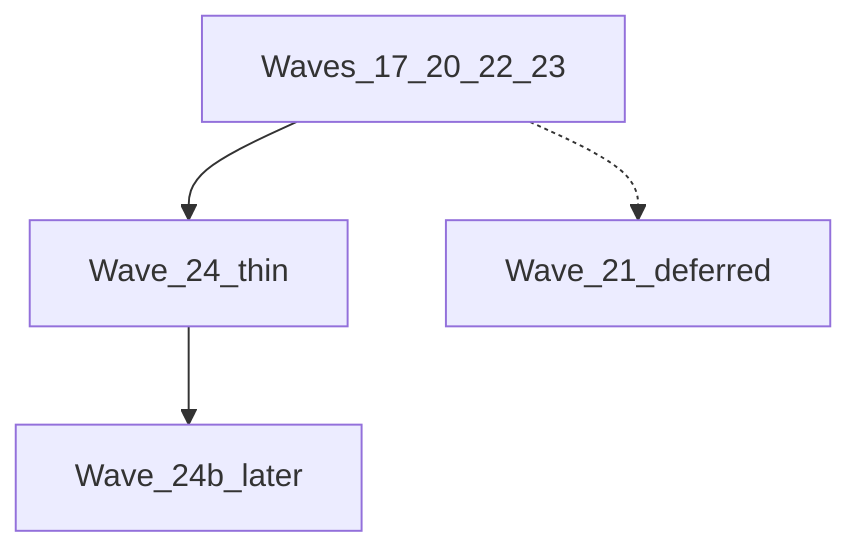

# Wave 24 — Chat actions & settings chrome (proposed)

**Status:** Plan only — **do not implement** until you say go.  
**Why next:** Wave 22 done; Wave **21 Channels** still deferred (your earlier skip). This is the highest-value unfinished work that is *not* channels/backup/E2EE.

---

## What’s still missing (short map)

| Area | State | Wave |
|------|--------|------|
| Channels / communities | Mock UI, no backend | **21** (deferred) |
| Poll vote / event RSVP | Bubbles exist; handlers no-op | **24.1** |
| Privacy: photo / about / groups / calls | Local radios only | **24.2** |
| Font size / clear-all chats | No-ops | **24.3** |
| Storage & data numbers | Hardcoded 1.2 GB | **24.4** |
| Passkeys / companion link / email verify | Stubs | 24b+ |
| Cloud backup / stickers / live location / chat lock | Stubs or toast | 24b+ |
| Admin firewall / legal / stickers | Mock admin | after 21 / 24b |

**Prefer Channels instead?** Say **go Wave 21** and we replace this plan.

---

## Thin v1 scope

### 24.1 — Poll vote + event RSVP
Wire chat / event UI to existing `postMessagesIdVote` / `postMessagesIdRsvp` (and unvote/delete RSVP if present).  
**Exit:** both peers see updated vote/RSVP after send/refresh.

### 24.2 — Privacy sub-screens
Wire profile photo / about / groups / calls Settings to privacy API (extend DTO/fields as needed).  
**Exit:** setting on A applies for peer visibility / device B.

### 24.3 — Font size + clear/delete all chats
Persist font scale; clear-all / delete-all with confirm using existing per-chat APIs (loop) or one bulk route if trivial.  
**Exit:** font survives restart; clear-all empties chats for me.

### 24.4 — Storage (read-only real numbers)
Thin `GET /api/me/storage` + replace hardcoded GB in Manage storage. Auto-download stays local prefs.  
**Exit:** no fake “1.2 GB” as the only figure.

## Out of scope (24b / later)

Channels (21), passkeys, companion QR, cloud backup, stickers store, live location, chat lock, admin firewall/legal, E2EE.

## Execute order (when approved)

1. 24.1 vote/RSVP → 2. 24.2 privacy → 3. 24.3 font/clear-all → 4. 24.4 storage → docs.

## How to approve

Reply **go Wave 24** (or **go Wave 21** for channels instead).
